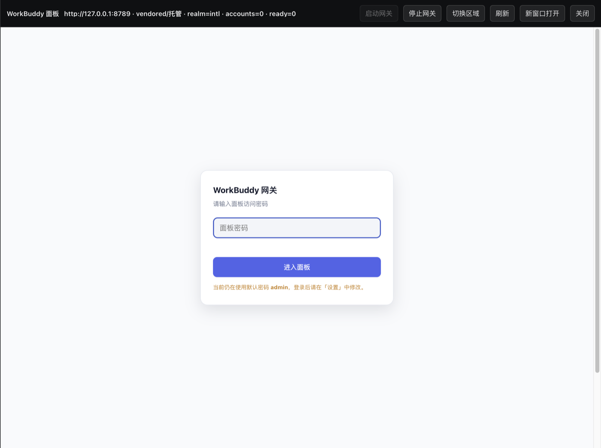

# dsh-workbuddy

[](https://github.com/kekesharp/dsh-workbuddy/stargazers)
[](LICENSE)
[](https://github.com/deepseek-ai)
[](#前置条件)
[](#前置条件)

> **把 WorkBuddy / CodeBuddy 的订阅额度接进 DeepSeek Harness —— 网关自带、随 DSH 启停、面板内嵌，不用再手动开一个终端窗口跑代理。**

<sub>*English: A DSH plugin that bundles the WorkBuddy/CodeBuddy gateway. It starts with DSH, stops with DSH, self-heals when it crashes, and embeds the official web panel right inside DSH — no separate install, no terminal window, no manual supervision.*</sub>



---

## 30 秒上手

```bash
dsh plugin --profile desktop add github:kekesharp/dsh-workbuddy
```

然后**配置 provider**（这一步不能跳过，见「安装」）并重启 DSH。右下角会出现图标，点开就是面板。

---

## 为什么用它

| | 手动跑网关 | 大多数同类插件 | **本插件** |
|---|:---:|:---:|:---:|
| 需要单独安装网关 | 要 | 多数要 | **自带** |
| 占一个终端窗口 | 占 | — | **不占** |
| 关终端后网关变僵尸 | 会 | — | **不会**（不碰 tty） |
| DSH 关了后台还留进程 | 会 | — | **一起停** |
| 网关中途挂了 | 手动重启 | 手动重启 | **看门狗自愈** |
| 看面板要开浏览器 | 要 | 要 | **DSH 内嵌** |
| 切区域要登面板 | 要 | 要 | **一键** |
| 装完出问题 | 自己猜 | 自己猜 | **一键自检** |

---

## 安装

### 1. 装插件

```bash
dsh plugin --profile desktop add github:kekesharp/dsh-workbuddy
# 想同时给 web profile 用：
dsh plugin --profile web add github:kekesharp/dsh-workbuddy
```

### 2. 配置 provider（**必做**）

插件负责**网关**，但让模型出现在 DSH 的模型列表里，需要你自己在 profile patch 里声明 provider：

```yaml
# ~/.dsh/profiles/desktop/cordis.patch.yml —— 顶层追加
- id: llm-pi-ai
  config:
    providers:
      workbuddy:
        displayName: WorkBuddy
        api: openai-completions
        apiKeyEnv: WORKBUDDY_API_KEY
        baseURL: http://127.0.0.1:8788/v1
        defaultInput: [text, image]
        models:
          - id: deepseek-v4.1-flash
            name: DeepSeek V4.1 Flash
            contextWindow: 1000000
            maxTokens: 128000
            input: [text, image]
            reasoningEfforts: [off, low, high, max]
```

并在 `~/.dsh/.credentials.yaml` 的 `refs` 里给这个 key 一个占位值（网关默认不校验它）：

```yaml
refs:
  WORKBUDDY_API_KEY: local-proxy
```

> ⚠️ 两个最常踩的坑：
> - **漏了 `apiKeyEnv`** → 请求报 `No API key for provider: workbuddy`
> - **模型没写 `contextWindow` / `input`** → 要么长会话报 `context overflow`，要么图片直接被拒

### 3. 重启 DSH

bundle 层是启动时加载的。重启后右下角出现图标即成功。

### 前置条件

- **DSH** 0.2.0-rc.2 或更新
- **Python 3.9+** —— macOS 自带的 `/usr/bin/python3` 即可；插件会自动探测，也可用 `pythonPath` 指定
- 一个已登录的 WorkBuddy / CodeBuddy 账号（在面板里登录一次）

---

## 界面

右下角是一个 32px 圆角图标（仿 WorkBuddy 图标），状态点三色：

| 颜色 | 含义 |
|---|---|
| 🟢 绿 | 网关在线且账号就绪 |
| 🟡 黄 | 网关在线但没账号/未登录 |
| 🔴 红 | 网关离线 |

悬停显示 `realm · ready/total 账号`，**不占界面**。点开是抽屉：内嵌官方 Web 面板 + 一排操作按钮。


---

## 内置网关与生命周期

网关（`workbuddy2api` 系）**已经打包在插件里**（`vendor/wb-proxy`，约 1.6 MB），不需要另外安装。

### 随 DSH 启停

- **随 DSH 启动**：`autoStart: true` 时 DSH 一起来就探测，没跑就拉起，并**轮询等到就绪**
- **随 DSH 停止**：`stopOnExit: true` 时 DSH 退出会停掉由本插件启动/接管的网关（SIGTERM → `stopGraceMs` → SIGKILL）
- **不碰别人的进程**：如果端口上跑的是你自己起的网关，插件只探测、不接管，退出时也不去停它
- **挂了会自愈**：`watchdog: true`（默认）时，健康检查发现网关**连续两次**不可达就自动重拉，中断窗口约 30 秒

> 判定用「连续两次」而不是单次，是为了避免上游一时卡顿就误重启、反而打断健康的网关。
> 两次重启之间有 `watchdogCooldownMs`（默认 30 秒）冷却，防止拉起风暴。

### 代码目录与数据目录分离

```
代码：<插件>/vendor/wb-proxy/          （或外部安装目录）
数据：~/.dsh/workbuddy-gateway/        （accounts / usage / settings / 日志 / pidfile）
```

好处是**换代码来源不会丢登录态**。首次启动时如果数据目录还没有 `accounts/`，插件会**自动从旧装迁移**（默认探测 `~/workbuddy2api-hub/wb-proxy`、`~/wb-proxy`，也可用 `legacyDataDir` 指定），不用重新登录。

### 三种来源

| `mode` | 行为 |
|---|---|
| `auto`（默认） | 有内置网关就用内置；否则回退到 `gatewayDir` / `launchScript`；都没有则只探测 |
| `vendored` | 强制用插件自带的 `vendor/wb-proxy` |
| `external` | 强制用外部安装的网关 |
| `off` | 只探测，从不启动 |

内置模式下插件直接 `python3 wb_proxy.py`，参数带 `--port` / `--accounts-dir` / `--usage-dir` —— **不经过任何 shell 启动脚本**，所以没有 CRLF、PATH、终端挂起之类的问题。

---

## 装完不对劲？先跑自检

```bash
curl -s http://127.0.0.1:19387/workbuddy/diagnose | python3 -m json.tool
```

它会逐项告诉你哪一环断了，并给出 `hints`：

```
✅ mode             vendored
✅ vendorGateway    /…/vendor/wb-proxy
—  externalGateway              ← 当前模式不适用
✅ python           python3
✅ dataDir          /…/workbuddy-gateway
✅ accounts         /…/workbuddy-gateway/accounts
✅ port             port 8788
ℹ️ log              /…/dsh-gateway.log
ℹ️ managed          pid 36177
```

`✅` 通过 · `❌` 真有问题 · `—` 不适用 · `ℹ️` 信息项。

---

## 配置

写在 `cordis.patch.yml` 的 `config`，或你自己的 profile 覆盖层：

```yaml
- id: workbuddy
  config:
    panelPassword: <你的面板密码>
    # 需要时再覆盖下面这些
```

| 键 | 默认 | 说明 |
|---|---|---|
| `mode` | `auto` | `auto` / `vendored` / `external` / `off` |
| `autoStart` | `true` | DSH 启动时未运行则拉起 |
| `stopOnExit` | `true` | DSH 退出时停止（仅限本插件托管的） |
| `watchdog` | `true` | 网关挂了自动重拉 |
| `watchdogCooldownMs` | `30000` | 两次自愈重启最小间隔 |
| `gatewayUrl` | `http://127.0.0.1:8788` | 面板 iframe 与 `/health` 探测都用它 |
| `gatewayPort` | `8788` | 须与 `gatewayUrl` 端口一致 |
| `dataDir` | `~/.dsh/workbuddy-gateway` | accounts / usage / 日志 / pidfile |
| `pythonPath` | 自动探测 | Python 3.9+ 的绝对路径 |
| `vendorDir` | 插件自带 | 内置网关目录 |
| `gatewayDir` | — | 外部网关目录（含 `wb_proxy.py`） |
| `launchScript` | — | 外部启动脚本（`mode: external` 时用） |
| `legacyDataDir` | 自动探测 | 迁移账号的来源 |
| `panelPassword` | — | 面板密码；留空则面板需手输、且不能切区域 |
| `healthIntervalMs` | `15000` | 后台健康检查间隔；`0` = 关闭 |
| `startTimeoutMs` | `25000` | 拉起后等就绪的上限 |
| `stopGraceMs` | `5000` | SIGTERM 后多久 SIGKILL |
| `logPath` | 数据目录下 | 网关 stdout/stderr 落盘位置 |

> **profile 层对 `config` 是替换语义，不是深合并** —— 只写要覆盖的字段即可，其余由插件默认值兜底。
> 这是**顶层 `- id: workbuddy`**，**不是** `- insert:`（用 `insert` 会因 id 重复导致加载失败）。

---

## 接口

挂在你 DSH 的源上（默认 `http://127.0.0.1:19387`）：

| 方法 | 路径 | 说明 |
|---|---|---|
| GET | `/workbuddy/status` | 可达性 + `/health`，含 `mode` / `python` / `dataDir` / `managed` / `stopOnExit` |
| GET | `/workbuddy/diagnose` | **一键自检**，逐项 + `hints` |
| POST | `/workbuddy/gateway/start` | 拉起并轮询等就绪；失败返回 `logTail` |
| POST | `/workbuddy/gateway/stop` | 停止本插件托管的网关 |
| GET | `/workbuddy/models` | 代理网关 `/v1/models` |
| GET / POST | `/workbuddy/realm` | 查看 / 切换上游出口 `{"realm":"cn"\|"intl"}` |

---

## 排错

| 现象 | 处理 |
|---|---|
| 右下角没有图标 | bundle 未加载 → 重启 DSH；检查 `package.json` 的 `dsh.profile.bundles` 是否含 `dsh-workbuddy` |
| 启动弹崩溃窗「web boot: 1 entry did not activate」 | `client.js` 不是 DSH 模块格式（见「实现约束 3」） |
| 模型列表里没有 WorkBuddy | provider 没配 → 见「安装 第 2 步」 |
| 请求报 `No API key for provider: workbuddy` | provider 缺 `apiKeyEnv`，或 credentials `refs` 没有对应键 |
| 长会话报 `context overflow` | 模型没写 `contextWindow`，pi-ai 回退到约 256K 兜底 → 补上真实窗口 |
| 图片被拒 | 模型/路由缺 `input: [text, image]` |
| 模型报 `TRANSPORT` 错误 | 网关挂了。等看门狗自愈（约 30 秒）后重试；或跑 `/workbuddy/diagnose` |
| 「启动网关」报 `port is already in use` | 端口被占。多半是终端里起过、关终端后被 `SIGTTOU` 挂起（`STAT=T`）的僵尸，见下 |
| 面板提示「无法连接反代」/ 添加账号 405 | 做了路径前缀反代。必须让 iframe **直连** `gatewayUrl`（见「实现约束 1」） |
| 切区域返回 401 | `panelPassword` 与面板当前密码不一致 |
| 迁移没生效（账号仍是 0/1） | 目标 `dataDir` 已有 `accounts/` 时不会迁移；先清空或用 `legacyDataDir` 指定 |

### ⚠️ 不要再手动在终端里跑网关

尤其**不要前台启动后再关掉终端窗口**——进程会收到 `SIGTTOU` **被挂起（`STAT=T`）**：既不死也不干活，**却继续占着端口**。

```bash
lsof -nP -iTCP:8788 -sTCP:LISTEN        # 1. 找出占端口的进程
ps -o pid,ppid,stat,command -p <PID>    # 2. 确认是不是 STAT=T
kill -9 <PID>                           # 3. 清掉
# 4. 重启 DSH，交给插件 autoStart
```

---

## 实现约束（改代码前先读）

### 1. 面板必须**直连**网关源站

面板前端用**绝对路径**调自己的 API（`/panel/status`、`/accounts/*`、`/realm`…）。任何「路径前缀式」反向代理只能覆盖被改写过的相对路径，绝对路径请求会落到 DSH 源上并 404/405，表现为「无法连接反代」+ 添加账号 405。

网关源站没有 `X-Frame-Options` / CSP，所以跨源 iframe **可以直接嵌入**。

### 2. `webServer` 是后注入服务

`ctx.get('webServer')` 在 `apply()` 里是 `undefined`，把 `webServer` 列进 `inject` 又会让插件在 headless/Electron 组合里永不加载。正确做法是 `ctx.inject(['webServer'], cb)`：依赖就绪时执行回调，不就绪时插件照常加载，只是不注册 HTTP 路由。

### 3. 浏览器端入口必须是 DSH 的模块格式

```js
window.__ModuleLoader__.load({ id: 'dsh-workbuddy', factory })
// factory(require) 必须 return exports，且 exports 要带 apply
```

写成裸 IIFE 会让 DSH 启动时崩溃（`web boot: 1 entry did not activate`）。

### 4. 网关进程要落日志、补 PATH

`stdio: 'ignore'` 会让启动失败的原因彻底丢失（只剩一句 `HTTP 200`）。必须把 stdout/stderr 写进文件；并显式补 `PATH`，因为 GUI 启动的 DSH 未必继承登录 shell 的 PATH。

---

## 同类项目

| 项目 | ★ | 路线 | 与本插件的关系 |
|---|---|---|---|
| [corrinehu/dsh-workbuddy-connect](https://github.com/corrinehu/dsh-workbuddy-connect) | 353 | 直读桌面 App 内模型 | 不同路线：不需要网关 |
| [Axiaohungry/dsh-llm-workbuddy](https://github.com/Axiaohungry/dsh-llm-workbuddy) | 56 | API Key 接模型 | 只做 provider，无面板 |
| [tearslee/dsh-workbuddy2api](https://github.com/tearslee/dsh-workbuddy2api) | 4 | 守护网关 + 自动注册 provider | 无面板 |
| [Wei894348/dsh-wb2api](https://github.com/Wei894348/dsh-wb2api) | 0 | 自建网关 + 面板 | 更重：自己实现网关 |
| [ardeyouxipianyi/workbuddy2api-hub](https://github.com/ardeyouxipianyi/workbuddy2api-hub) | 793 | 网关本体 | 本插件内置的就是它 |

**本插件的定位**：不重造网关，把网关**打进来**并管好生命周期，同时把官方面板嵌进 DSH。

---

## 许可证与致谢

MIT。

内置网关来自 [ardeyouxipianyi/workbuddy2api-hub](https://github.com/ardeyouxipianyi/workbuddy2api-hub)（MIT，见 `vendor/wb-proxy/LICENSE.gateway`），仅做打包与生命周期托管。

> 本项目与 WorkBuddy / CodeBuddy / DeepSeek 官方无关，仅供个人在自有账号下使用。
